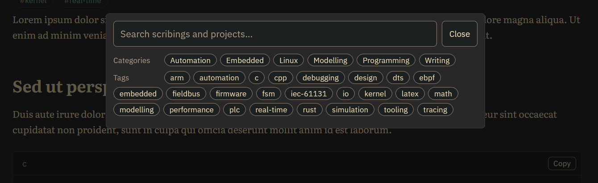
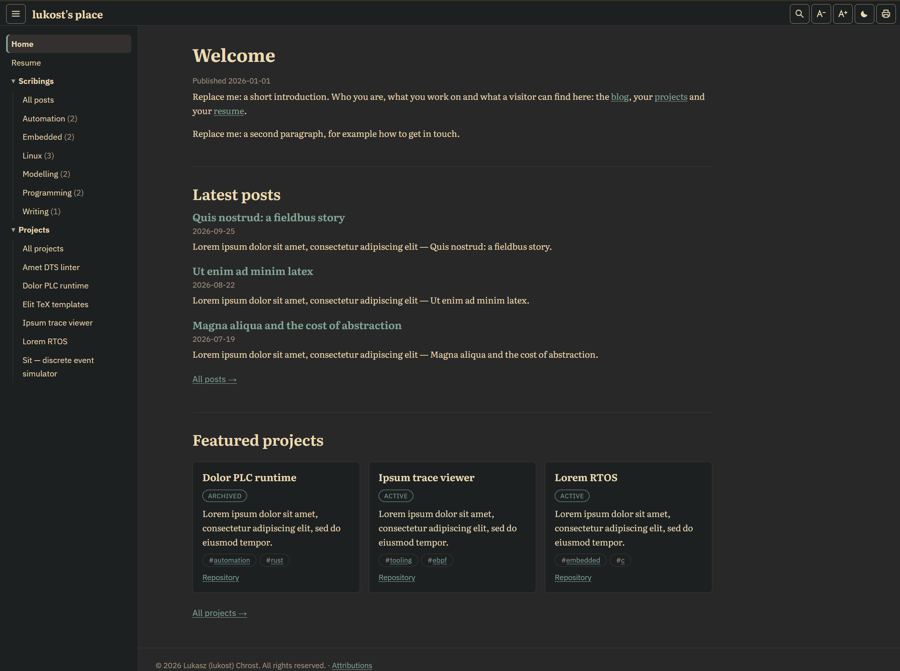
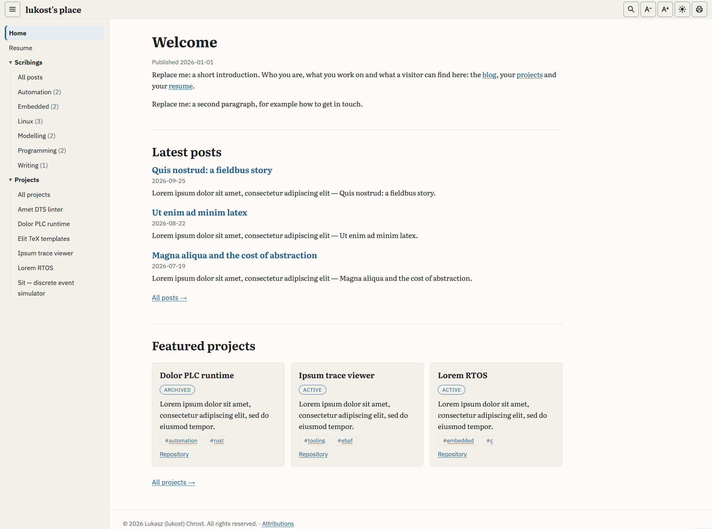

# inkbothy

Writing in a plain, free-to-use shelter. inkbothy is a deliberately simple static site generator: a directory of Markdown in, a deployable directory out.

<picture>
  <source media="(prefers-color-scheme: dark)" srcset="docs/images/welcome_dark.png">
  
</picture>

## What it does

- Sections of articles in three layouts: a scrolling stream, a card grid or a plain list. Categories and tags, with a page per term.
- Pages, a structured resume, a home page assembled from latest and featured items.
- Full-text search in the browser, from an index built with the site.
- Syntax-highlighted code with titles, line numbers and line highlighting; Mermaid diagrams; footnotes, task lists, tables and GitHub-style alerts.
- Light and dark themes, adjustable text size, print styles, a sitemap and `robots.txt`.
- A strict Content-Security-Policy generated for the site, with host headers ready to use.
- Content-addressed asset names and a publish step that keeps the modification time of unchanged files, so `rsync -rt` uploads only what changed.
- A live-reloading preview server.





## What it deliberately does not do

No plugins, no themes to install, no template language, no nested sections, no pagination, no server-side code. Sections are one level deep, each has one of three fixed layouts, and the look is fixed. If you need more, inkbothy is small enough to fork.

## Requirements

- Node.js 24 or newer (it runs the TypeScript sources directly)
- `make`

## Quick start

```sh
git clone <this repository> inkbothy
cd inkbothy
npm ci
make init-site        # copies site.sample/ to ./site
make serve            # builds, publishes and serves http://127.0.0.1:8000/
```

Edit `site/site.yaml` and the Markdown under `site/`; the preview rebuilds and reloads on every change. `make build` writes `build/`, `make publish` writes the deployable `publish/`.

## Your site lives apart from the generator

The generator and the site are separate things. The site is one directory with `site.yaml` at its top, selected by `SITE=<dir>` (or `SITE_DIR`, or `--site`), `./site` by default. It can be its own Git repository, a submodule, a symlink or any path:

```sh
git submodule add -f <your site repository> site   # -f: site/ is git-ignored here
make serve
# or anywhere else:
make serve SITE=~/websites/mine
```

Pulling a new version of inkbothy never conflicts with your configuration or content.

## Deploy

```sh
make publish SITE=~/websites/mine
rsync -rt --delete --exclude .generated publish/ user@host:/var/www/site/
```

Apply the policy in `publish/_headers.txt` (or `_csp.txt`) in your web server. See [the CLI reference](docs/cli.md#deploy).

## Documentation

- [Authoring](docs/authoring.md): site layout, front matter, Markdown, resume
- [site.yaml reference](docs/site-yaml.md): every configuration key
- [CLI and Make reference](docs/cli.md): flags, environment variables, exit codes, deploying
- [Architecture](docs/architecture.md): pipeline, modules, security model
- [Guide for AI agents writing content](docs/agent-guide.md)

## Development

`make check` runs the linter, the type checks and the tests with coverage.

## Licence

MIT, Copyright (c) 2026 Lukasz Chrost (lukost); see [LICENSE](LICENSE). Fonts and other third-party files in `data/` keep their own licences, which are listed on the generated attributions page of every site.
